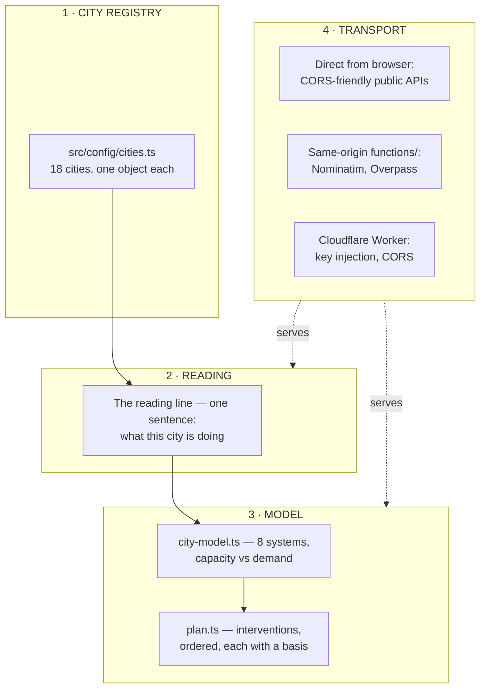

# SYSTEM.md — how City Hub is put together

For someone reading the repository cold. The README says *what* the project is
and how to run it; this says **how the pieces fit and why the boundaries are
where they are**.

Read this before changing a fetcher, a transport, or a data contract.

---

## The one-sentence version

A city is modelled as a set of **systems with capacity and demand**; the map is
the ground those readings are taken against; and every number on screen says
whether it was measured, derived, or assumed.

---

## Four layers



### 1 · City registry — `src/config/cities.ts`

One `CityConfig` object per city. Adding a city is adding an object. Nothing
else branches on city identity except `tier`.

| Field | Why it exists |
|---|---|
| `center` | `[lng, lat]`. Order matters — see *coordinate order* below. |
| `bbox` | `[west, south, east, north]`. |
| `tier` | `full` = dedicated endpoints exist. `lite` = global open sources only. |
| `kpis`, `demographics` | Static, cited reference figures. Not live claims. |
| `area_km2`, `populationMillions` | Inputs to the capacity model. |
| `threeD`, `buildings3dUrl` | Opt into the 3D twin path. |

**Coordinate order** is `[lng, lat]` here and `[s, w, n, e]` inside Overpass
bbox strings. Three of these fields have different orders. Getting one wrong
produces a query that is syntactically valid, returns HTTP 200, and silently
describes the wrong place — so `studyBounds()` in `src/data/city-image.ts` is
the reference implementation and it is destructured explicitly.

### 2 · Reading — `src/lib/city-reading.ts`, `src/content/research.ts`

The line under the title is the finding for the current city, then what the
current frame covers. `CLAIMS` holds a specific line per city only where there
is a real finding; every other city gets an honest "the same questions as the
others" rather than an invented postcard.

### 3 · Model — `src/lib/city-model.ts`, `src/lib/plan.ts`

Eight systems — housing, water, drainage, transit, air, heat, health, waste —
each with a capacity, a demand, a utilisation, and a caveat.

**The honesty contract.** Every coefficient carries `basis: 'measured' |
'derived' | 'assumed'` and a named source. Norms live in one exported table
(`NORMS`) so a planner who disagrees with, say, the 9 m²/person green-space
figure swaps one constant and the whole model re-solves.

Two invariants that are easy to get backwards and are regression-tested:

- **transit utilisation reads downward.** Capacity is the benchmark, demand is
  actual mode share. Above 1.0 means *better*, not worse.
- **heat is not inverted.** Capacity is green space on the ground, demand is the
  green the norm requires. More green than target is headroom. Getting this
  backwards tells a green city it has a heat crisis.

### 4 · Transport

Three tiers, chosen per API:

| Tier | When | Constraint |
|---|---|---|
| Direct | CORS-friendly, keyless (Open-Meteo, USGS, NASA GIBS) | — |
| Same-origin function | Upstream needs a header JavaScript cannot set, or a rate limit | `functions/api/*.ts` |
| Cloudflare Worker | Key injection, or several upstreams | `worker/` |

**Why `functions/` exists at all.** `User-Agent` is a *forbidden header name*
in the Fetch standard — a browser silently discards whatever a script sets and
sends its own. The public OSM mirrors rate-limit by User-Agent. Measured
2026-10-15:

| User-Agent sent | overpass-api.de |
|---|---|
| `CityHub/0.9 (…)` | HTTP 200 |
| `Mozilla/5.0 … Chrome/131` | HTTP 406 |

No client-side change can fix that, because the one header that fixes it is the
header the browser will not let JavaScript set. Nominatim was moved
server-side for this reason (`nominatim-upstream.ts` documents it); Overpass now
is too. `src/lib/osm/overpass-http.ts` carries the reasoning and the numbers.

### "Busy" is not "rejected"

Overpass is a free, volunteer-run service and says so when it is saturated.
Measured 2026-10-15 under load, with the real city-image query:

| Mirror | Answer |
|---|---|
| `overpass-api.de` | `502` — *"All query workers are busy and the request queue is full. Retry your request using exponential backoff"* |
| `kumi.systems` | `500` |
| no User-Agent | `429` |

`OverpassClient` therefore distinguishes **backpressure** (429/500/502/503/504 —
come back later) from a **verdict** (406 — your request was rejected). Only
backpressure spends retries: `OVERPASS_MAX_ROUNDS` full passes over the mirror
list, `overpassRetryDelayMs` backoff with jitter between them, capped so a single
request never sends more than 9 queries to a free service.

This mattered in practice. The earlier client treated only 429/504 as retryable
and never repeated a mirror, so one saturated primary ended the sweep in ~2s and
the UI showed *"Public map data unavailable"* — for a mirror that answers the
identical query in ~24s once the queue drains. The honest failure state is still
there and still 503; it just no longer fires on a service that is merely busy.

**The server must answer before the client gives up.** `OVERPASS_TIMEOUT_MS`
(90s) is the budget the browser enforces on itself; `OVERPASS_DEADLINE_MS`
(75s) bounds the whole server-side request — every mirror, every retry, every
backoff, and each attempt is further capped to the time actually left. Without
that ceiling, retries made the *server* slower than its own caller: the client
aborted at 90s mid-flight, and a failure reached the user as a silent abort
instead of a 503 that says why. Verified live: a saturated read now returns
**503 at 75.1s**, answering in its own words instead of being cut off.

In the browser the single "mirror" is this proxy, which has already spent its
retry budget, so the browser client asks it **once** (`maxRounds: 1`) — retrying
an already-answered proxy means paying the same wait twice for one question.

---

## Data contracts

### A fetch failure is never an empty result

An empty `FeatureCollection` reads as *"this city has no paths, no nodes, no
landmarks."* That is a **claim about the city** and it is false. Upstream
failure returns **503** with a message that says the record is unavailable.

This is enforced in `tests/overpass-proxy.spec.ts`:
`expect(body).not.toHaveProperty('elements')` on the failure path.

### Absent-in-a-truncated-sample ≠ absent-in-the-city

The city-image query caps at 1200 elements. A truncated response that matched
nothing must say so rather than reporting "No matching features in this study
window."

### Every displayed number declares its provenance

Three mechanisms, in increasing order of preference:

1. **`basis` chips** (`MEASURED` / `DERIVED` / `ASSUMED`) on model rows.
2. **`DemoBadge`** (`src/components/DemoBadge.tsx`) on synthetic figures.
3. **`as_of` provenance** — the caption under a number names its source period.

A consumer that renders a figure without one of these is a bug, even if the
figure happens to be real.

### Layer tiers

`layerDataTier()` in `src/config/bangkok-layers.ts` returns `feed`,
`reference`, `simulation`, `configured`, or `pending`. It describes the **data
contract**, not runtime health — a `configured` layer can be offline right now,
and runtime health belongs to `DataSourceStatus`.

### A basemap that stamps the product is worse than a basemap with no labels

The raster basemaps draw place-name labels from OpenStreetMap via CARTO. Every
`basemaps.cartocdn.com` endpoint — `dark_only_labels`, `rastertiles/voyager_labels`,
`dark_nolabels` — answers a request with **no `api_key`** with a black tile
stamped diagonally:

```
API KEY REQUIRED
carto.com/basemaps/apikey
```

Measured 2026-10-16 by fetching the exact tile the app requests. That label layer
is baked into *every* raster style, so the stamp covered the product's primary
surface — the single most damaging thing in the whole app.

Two things this is **not**:

- **Not Esri.** `server.arcgisonline.com` World Imagery serves clean tiles with
  no key. Chasing the wrong provider is easy here because Esri's terms changed
  too, and the credit line already names it.
- **Not fixable by switching to OSMF.** `tile.openstreetmap.org` now answers this
  app with an explicit `403` tile: *"App is not following the tile usage policy
  of OpenStreetMap's volunteer-run servers."* That is why this repo never used it.

So there is no keyless replacement that respects OSMF's policy. `src/lib/osm/tiles.ts`
therefore configures labels **only** with `VITE_CARTO_API_KEY`, and omits the
source and layer entirely without one — clean imagery instead of a stamped map.
Attribution is empty in that case, because no OSM labels are on screen and
crediting an absent source would be a claim the map is not making.

**Before adding any tile or imagery source, fetch one tile unauthenticated and
look at it.** A 200 response can still be a watermark, and a proxy-friendly
status code says nothing about whether the pixels are shippable.

---

## Costs worth knowing before you add a fetch

Public APIs are free to call and rate-limited to be unpleasant about it.
**One upstream request can be minutes long.**

The city-image query measured **52–55 seconds** against overpass-api.de. That
is not a hang; it is 1200 geometries with names. Two consequences, both
enforced by test:

- The upstream budget (`CITY_IMAGE_QUERY_TIMEOUT_S`, 60s) must exceed nothing,
  and stay below the client budget (`OVERPASS_TIMEOUT_MS`, 90s). A 12s budget
  produces HTTP 502 — the gateway abandons work that was about to succeed.
- Anything this slow **must be cached**. `OverpassClient` caches 24h in-process
  and the proxy response is `s-maxage=86400` at the CDN. One person waits once;
  everyone else is served from cache.

If you add a fetcher, measure its real cost before setting its timeout. Do not
pick a number because it sounds reasonable.

---

## Testing

```bash
npm test              # Playwright — unit and contract specs under tests/
npm run test:e2e      # Playwright — real browser against a built app (tests-e2e/)
npx tsc -b            # typecheck
npm run build         # production bundle
```

`tests/` are Playwright specs, not browser E2E — they import modules directly
and assert contracts. `tests-e2e/` drives a real browser and needs a built app.

**`npm test` does not run `tests-e2e`.** Verified the hard way on 2026-10-15:
moving OSM traffic behind a same-origin proxy changed the path the browser
actually requests, while `tests-e2e/city-image.spec.ts` kept mocking
`**/api/interpreter`. The browser then hit the real network, every e2e journey
failed, and `npm test` stayed at 61 green — because the suite that would have
noticed does not run. Run both before calling anything done.

Route mocks must target the URL the **browser** requests, not the upstream URL
the server will eventually call.

**A regression test should name the defect it prevents.** Every fix in this repo
that mattered came with one, and several carry the measurement inline:

```ts
test('the client budget exceeds the upstream query budget', async () => {
  // Measured 2026-10-15: upstream [timeout:12] → 502; [timeout:60] → 200 in 55s
})
```

**And check the failure mode is genuinely gone, not merely quieter.** The blank
City-image pane was visible in a screenshot and provable in one line of DOM: if
the basemap had been stripped, a camera move would request no tiles.

---

## Conventions

- **Sharp edges only.** No rounded corners, no gradients, no shadows, no blur.
- **Type everything.** No `as unknown as` to bridge a shape mismatch — that cast
  is how a fabricated object stayed in `talent-support-dashboard` for months. If
  the types disagree, one of them is wrong. Find out which.
- **Subtraction is beauty.** Before adding a panel, ask what it replaces.
- **Never fabricate.** Not a number, not a feature, not a placeholder collection.
  Every empty state should be honest about *why* it is empty.
- **Bilingual where the city is Thai.** `nameLocal`, IBM Plex Sans Thai, TMD
  descriptions, iTIC incident labels.

---

## Where things live

| Path | What |
|---|---|
| `src/config/cities.ts` | City registry — the replicability layer |
| `src/config/bangkok-layers.ts` | Layer catalog + `layerDataTier()` |
| `src/lib/city-model.ts` | Systems, capacity, demand, honesty contract |
| `src/lib/plan.ts` | Model → ordered interventions |
| `src/lib/city-reading.ts` | The reading line |
| `src/lib/city-baseline.ts` | Hazard profile per city |
| `src/lib/wada-engine.ts` | Sanzo Wada plate palette |
| `src/lib/osm/` | Nominatim + Overpass, server-side |
| `src/lib/request-timeout.ts` | `timeoutSignal`, shared |
| `src/data/` | One module per upstream, parse + cache + provenance |
| `functions/api/` | Same-origin proxies for headers JS cannot set |
| `worker/` | Cloudflare Worker: keys, CORS, Gemini / TimeFM / Earth Engine |
| `docs/` | Audits, research notes, dated session records |
| `tests/` | Contract + regression specs |

---

## Related

- [README.md](README.md) — what it is, how to run it
- [CONTRIBUTING.md](CONTRIBUTING.md) — running a fork, what PRs we want
- [SECURITY.md](SECURITY.md) — reporting a vulnerability
- [STORY.md](STORY.md) — why the UNL tiles were dropped
- [docs/DESIGN-AUDIT-LYNCH.md](docs/DESIGN-AUDIT-LYNCH.md) — the Lynch lenses and
  the limits of reading a mental map from OSM tags
- [docs/AUDIT-2026-10-15.md](docs/AUDIT-2026-10-15.md) — most recent audit